> **ARCHIVED — superseded by relayops-prod**

# Winback Ops

**An agentic revenue-recovery operator for local service businesses.**
OpenAI Build Week 2026 · Track: Work and productivity

Med spas and clinics sit on tens of thousands of dollars of dormant clients —
and the booking data needed to find them is a mess, different in every business.
Winback Ops doesn't just write marketing copy. It does the engineering:

1. **Upload** a raw booking export (CSV; supported schemas are profiled before use)
2. **Profile** — GPT-5.6 infers the schema, service taxonomy, and per-service
   treatment cadence (botox ≈ 90 days, laser ≈ 45, facials ≈ 30)
3. **Codegen** — the agent writes a segmentation script *custom to this
   dataset*, executes it in a sandbox, verifies it against a holdout, and
   repairs its own failures
4. **Revenue board** — dormant clients segmented by recoverable dollars
5. **Approve & send** — per-segment win-back sequences with revenue
   projections, gated behind human approval

## Architecture

```mermaid
flowchart LR
    U["Clinic CSV"] --> F["Next.js dashboard"]
    F -->|upload| A["FastAPI + SQLite"]
    A --> P["Profiler agent"]
    P --> C["Codegen agent"]
    C --> S["Restricted sandbox"]
    S -->|verification failure, max 3| C
    S --> R["Revenue segments"]
    R --> M["Campaign agent"]
    M --> H["Human approval"]
    H --> X["Mock email send"]
    A -->|SSE run status| F
```



## Quickstart

```bash
# backend
cd backend
python -m venv .venv && source .venv/bin/activate
pip install -r requirements.txt
cp ../.env.example .env   # add your OPENAI_API_KEY
uvicorn app.main:app --reload --port 8000

# frontend
cd frontend
npm install && npm run dev

# sample data
python scripts/generate_sample_data.py
```

## Local demo mode

The full workflow can run without API billing against deterministic local fixtures.
Set `DEMO_MODE=true` and `MOCK_SEND=true` in the repository `.env`; this makes the
profiler, codegen repair fallback, and campaign draft deterministic. It never makes
an OpenAI API call in this mode.

The UI labels these runs as `demo-*`. Demo mode is intended for fixture-based
evaluation only; it is not a claim that GPT-5.6 was called.

```bash
# one-command seed setup (creates clinic_a, clinic_b, clinic_c, and the adversarial fixture)
python scripts/generate_sample_data.py
```

Then start the backend and frontend in separate terminals:

```powershell
cd backend
python -m uvicorn app.main:app --reload --port 8000
```

```powershell
cd frontend
npm.cmd run dev
```

Open `http://localhost:3000`, then upload a file from `sample_data/` and complete:

1. **Profile this dataset**
2. **Run sandboxed segmentation**
3. **Draft win-back campaigns**
4. **Approve & mock send** on any campaign

The Agent activity panel should show `Profiler`, `Codegen`, `Sandbox`, and
`Campaign`. If the sandbox rejects generated output, it records the failure,
creates a visible `Codegen repair` attempt, and retries up to three times.

Use `clinic_adversarial.csv` to demonstrate robustness: it has a semicolon
delimiter, descriptive headers, mixed date and currency formats, altered service
labels, duplicates, and an invalid-date row that must be ignored. Raw uploads are
placed in `backend/data/uploads/` and are intentionally ignored by Git.

## Live API mode

Set `DEMO_MODE=false` and provide an API-billed `OPENAI_API_KEY` to call GPT-5.6
for profiling. OpenAI API billing is separate from ChatGPT and Codex credits.
Live model-generated code must run in an isolated RelayOps worker. This local
repository deliberately refuses that execution unless an explicit development-only
override is set.

## How Codex and GPT-5.6 were used

Codex accelerated the implementation of the FastAPI/Next.js workflow, seeded
fixtures, test coverage, and the run-visible agent pipeline. GPT-5.6 is used by
the live profiler through the Responses API. The local demo mode is deterministic
so judges can reproduce the workflow without API billing; it is clearly labelled
and does not make an API call. Before submission, add the required `/feedback`
Session ID and explain this distinction in the video.

You can also verify the API without the UI:

```bash
curl.exe -F "file=@sample_data/clinic_a.csv" http://localhost:8000/api/datasets
```

## Docs

- [`docs/PLAN.md`](docs/PLAN.md) — hackathon plan, architecture, schedule
- [`docs/DEMO_VIDEO.md`](docs/DEMO_VIDEO.md) — recording script and capture checklist
- [`docs/DEVPOST_WRITEUP.md`](docs/DEVPOST_WRITEUP.md) — ready-to-paste submission draft
- [`CODEX.md`](CODEX.md) — agent/contributor context
